About me 👋
=====================================================================================================================================


Coding powered by coffee☕
-------------------------

<div align="center">


<a href="https://www.linkedin.com/in/O-TEU-LINKEDIN"></a>
<a href="mailto:duartesantos@ua.pt"></a>
<a href="mailto:duarterainho@gmail.com"></a>


</div>

```console
duarte@santos:~$ cat about.txt
  role      MSc student, Informatics Engineering @ Universidade de Aveiro
  focus     cybersecurity - security monitoring, SIEM, log pipelines, network security
  building  hands-on labs that other students actually use in class
  daily     Arch Linux | Neovim | Docker | too much coffee ☕
  open to   internships / summer programmes in SOC, blue team or security engineering
```

```console
duarte@santos:~$ ls ~/projects --sort=impact
```

<!-- projects:start -->
<p align="center">
  <a href="https://github.com/Duarters07/MicroRato24"></a>
  <a href="https://github.com/Duarters07/MinimalSIEM"></a>
  <a href="https://github.com/Duarters07/stack-enterprise-network-lab"></a>
  <a href="https://github.com/Duarters07/.dotfiles"></a>
</p>
<!-- projects:end -->

```console
duarte@santos:~$ ls -l ~/degrees
```

<p align="center">
  <a href="https://github.com/PortableIsolatedEnvironment"></a>
  
</p>

```console
duarte@santos:~$ which --all tools
```

<p align="center">
  <br/>
  
</p>

<!-- Descomenta quando tiveres perfil em plataformas de CTF/treino:
```console
duarte@santos:~$ cat ~/.ctf/ranks
```
<p align="center">
  <a href="https://tryhackme.com/p/O-TEU-USER"></a>
</p>
-->

```console
duarte@santos:~$ neofetch --github
```

<p align="center">
  
</p>
<p align="center">
  
  
</p>

<div align="center"><sub>Always learning, always logging. <code>tail -f /var/log/duarte</code></sub></div>
